# Flowchart ของ logic ใน backend (เน้น dashboard)

ไฟล์นี้วาด logic ที่งงที่สุดเป็น flowchart (Mermaid) — เปิดดูได้ใน VS Code (ลง extension "Markdown Preview Mermaid Support") หรือบน GitLab/GitHub ได้เลย

สร้างจากการอ่านโค้ดจริงวันที่ 9 ต.ค. 2569 — ไฟล์ที่ครอบคลุม:
`middlewares/auth.js`, `requireRole.js`, `errorHandler.js` · `utils/roundPhase.js`, `academicYear.js` · `modules/rounds/*` · `modules/examResults/*` · `modules/students/*` (เฉพาะ logic หลัก) · `modules/dashboard/dashboard.service.js` + `dashboard.repository.js`

**ยังไม่ครอบคลุม:** `upload.js`, `rateLimit.js`, `requestLogger.js`, `student.export.controller.js`, `dashboard.pdf.js`, `dashboard.controller.js`

## สารบัญ

| # | เรื่อง | ไฟล์ต้นทาง |
|---|---|---|
| 1 | ทุก request ผ่านอะไรบ้าง | middlewares |
| 2 | `authenticate` ทีละด่าน | `auth.js` |
| 3 | `errorHandler` แปลง error → status | `errorHandler.js` |
| 4 | Phase ของรอบ (4 สถานะ) | `roundPhase.js`, `rounds.repository.js` |
| 5 | นักศึกษาส่งได้รอบไหน (`findSubmittableRound`) | `examResults.service.js` |
| 6 | นักศึกษากดส่งผลสอบ (`create`) | `examResults.controller.js` |
| 7 | วงจรสถานะของใบผลสอบ | `examResults.*` |
| 8 | เจ้าหน้าที่ยืนยัน/ตีกลับ + ล็อกแถว | `examResults.controller.js`, `.repository.js` |
| 9 | สร้าง/แก้/ลบรอบ | `rounds.controller.js` |
| 10 | นักศึกษา: import / โปรไฟล์ / เปิดสิทธิ์ / ลบ | `student.controller.js` |
| 11 | **Dashboard: ตัวเลขทุกตัวมาจากไหน** | `dashboard.service.js` |
| 12 | Dashboard: `buildStats` (รายรอบ) | `dashboard.service.js` |
| 13 | Dashboard: `buildYearSummary` (รายปี) | `dashboard.service.js` |
| 14 | Dashboard: ตัวอย่างคำนวณด้วยตัวเลขจริง | — |
| 15 | Dashboard: แจ้งเตือน (`buildAlerts`) | `dashboard.service.js` |

---

## 1. ทุก request ผ่านอะไรบ้าง

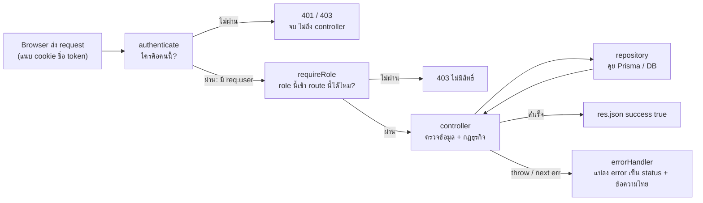

จำ 3 ข้อ:
1. `authenticate` ต้องมาก่อน `requireRole` เสมอ (requireRole อ่าน `req.user` ที่ authenticate สร้าง)
2. controller ไม่ส่ง error เอง ใช้ `throw httpError(msg, code)` → `catch → next(err)` → errorHandler
3. role อ่านจาก **DB** ทุก request (ไม่เชื่อ role ใน token, ไม่เชื่อ body)

---

## 2. `authenticate` ทีละด่าน (`middlewares/auth.js`)

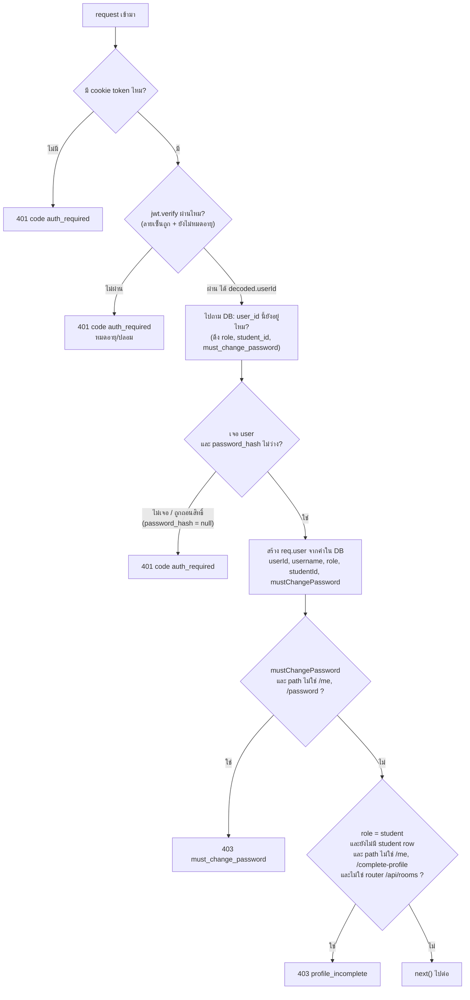

ทำไมต้องถาม DB ทุกครั้ง: token ที่ถูกต้องไม่ได้แปลว่าเจ้าของยังอยู่ (เช่น ถูกถอนสิทธิ์, seed ใหม่แล้ว user_id เปลี่ยน) และเปลี่ยน role แล้วมีผลทันที

`requireRole(...roles)` ง่ายกว่านี้: ไม่มี `req.user` → 401, role ไม่อยู่ใน list → 403, ไม่งั้น `next()`

---

## 3. `errorHandler` แปลง error → status (`errorHandler.js`)

ลำดับการตัดสิน status (เจอข้อไหนก่อนใช้ข้อนั้น):

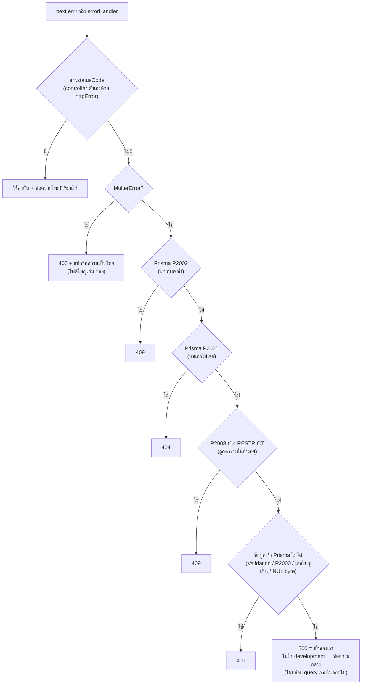

กฎสำคัญ: ถ้า controller ตั้ง `statusCode` เอง → ข้อความของ controller **ห้ามถูกเขียนทับ** ด้วยข้อความกลางของ Prisma

---

## 4. Phase ของรอบ (`utils/roundPhase.js`)

DB เก็บ `status` แค่ `open`/`closed` (เจ้าหน้าที่กดเอง) แต่ **phase คำนวณสดตามเวลา** ไม่เก็บลง DB

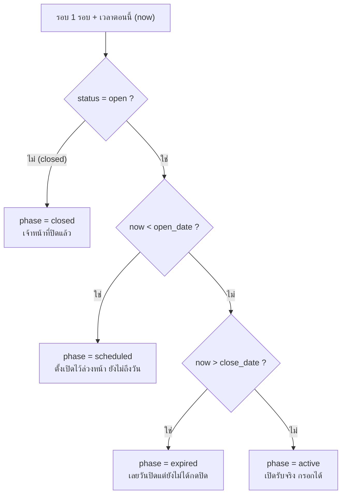

**สำคัญ:** `active` ต้องตรงกับเงื่อนไข `findActive()` ใน `rounds.repository.js` เป๊ะ:

```
status = "open"  AND  open_date <= now <= close_date  AND  academic_year = ปีของนักศึกษา
```

ฟังก์ชันค้นรอบใน `rounds.repository.js` ต่างกันตรงไหน:

| ฟังก์ชัน | เงื่อนไข | ใช้ทำอะไร |
|---|---|---|
| `findActive(year)` | open + อยู่ในช่วงวันที่ + ปีนี้ | **ตอนรับผลสอบจริง** |
| `findOpenForYear(year)` | open + ปีนี้ (ไม่ดูวันที่) | โชว์ "รอบหน้าเปิดวันที่…" เท่านั้น ห้ามใช้รับผล |
| `findLatestStarted(year)` | `open_date <= now` และ (status=open หรือ มีใบผลสอบ ≥ 1 ใบ) เอา attempt สูงสุด | หารอบล่าสุดสำหรับแก้ใบที่ถูกตีกลับ |
| `findOpen()` | status = open ทั้งระบบ | กันเปิด 2 รอบพร้อมกัน |
| `findNewerRoundWithResults` | ปีเดียวกัน, attempt มากกว่า, มีใบแล้ว | กันเปิดรอบเก่าซ้ำ |

---

## 5. นักศึกษา "ส่งได้" รอบไหน — `findSubmittableRound` (`examResults.service.js`)

ใช้ร่วมกัน 2 ที่: ตอนกดส่ง (`create`) และตอนโหลดหน้ากรอก (`getActive`) เพื่อให้หน้าจอกับ backend ตัดสินตรงกัน

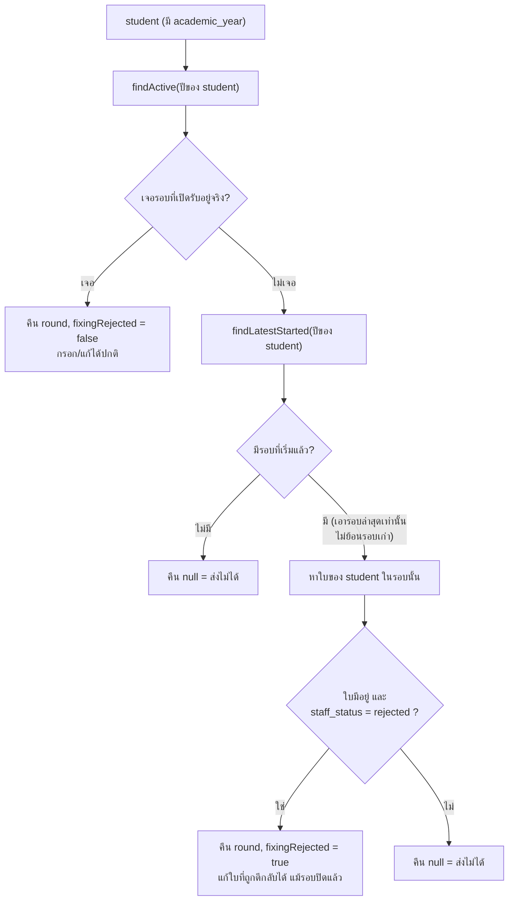

ทำไมดูแค่รอบล่าสุด: ถ้าย้อนไปแก้ใบรอบเก่า ผลที่ถูก "ยกไปรอบหลัง" (carry-forward) จะไม่ตรงกับใบต้นทาง

---

## 6. นักศึกษากดส่งผลสอบ (`examResults.controller.js` → `create`)

เป็นฟังก์ชันที่มีด่านเยอะสุด ไล่ตามลำดับในโค้ด:

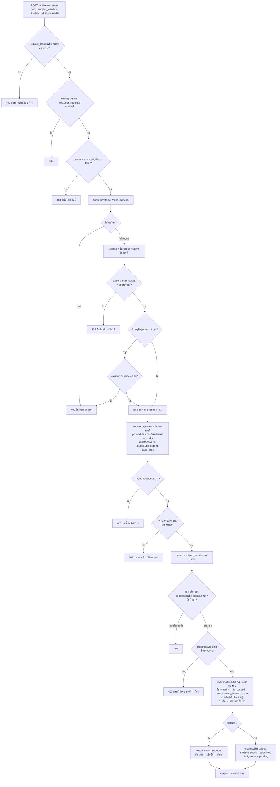

แนวคิดที่ต้องเข้าใจ:
- **carry-forward**: วิชาที่เคยผ่านแล้ว ระบบ copy มาเป็น "ผ่าน" ให้เองโดยติด `carried_forward = true` — สถิติจะ **ไม่นับ** แถวนี้เป็นการสอบจริง
- `findPassedSubjectIds` นับเป็น "เคยผ่าน" เมื่อ: `is_passed = true` + `carried_forward = false` + ใบนั้น **ไม่ถูกตีกลับ** (pending ยังนับ) + ไม่ใช่ใบของรอบที่กำลังกรอก
- ด่าน controller เป็นด่านแรกให้ข้อความชัด ส่วน **ด่านที่กันกดพร้อมกันจริงอยู่ใน repository** (`resubmitWithSubjects` ล็อกแถวแล้วเช็คซ้ำ)

---

## 7. วงจรสถานะของใบผลสอบ

ใบหนึ่งมี 2 คอลัมน์สถานะ: `student_status` (draft/submitted) กับ `staff_status` (pending/approved/rejected). ตอนนี้ `create` ตั้ง `student_status = submitted` เสมอ ดังนั้นสถานะที่เปลี่ยนจริงคือ `staff_status`

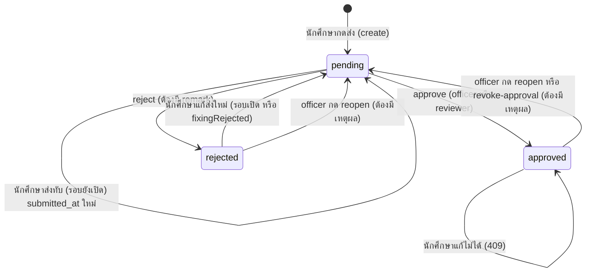

ตารางสิทธิ์ (จาก `examResults.routes.js`):

| การกระทำ | route | role |
|---|---|---|
| ส่งผลสอบ | `POST /` | student |
| ดูของตัวเอง | `GET /me` | student |
| อัปโหลด PDF | `POST /:id/certificates` | student |
| ดูทุกใบ | `GET /` | officer, reviewer |
| ยืนยัน / ตีกลับ | `PATCH /:id/approve` `/reject` | officer, reviewer |
| ถอนยืนยัน / แก้ผลการตรวจ | `PATCH /:id/revoke-approval` `/reopen` | **officer เท่านั้น** |

`executive` เข้า exam-results ไม่ได้เลย — ดูได้แค่สถิติที่ `/api/dashboard`

---

## 8. เจ้าหน้าที่ยืนยัน/ตีกลับ + ล็อกแถว (`reviewExamResult`)

approve กับ reject ใช้ฟังก์ชันเดียวกัน ต่างกันแค่ `staff_status` และ `requireRemark`

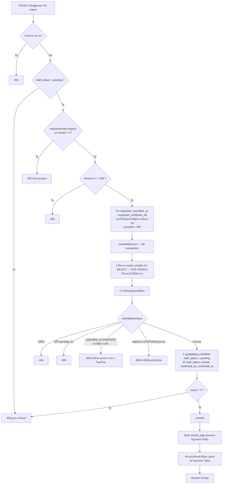

ทำไมต้องล็อก: ผู้ตรวจเปิดใบดูอยู่ → นักศึกษาลบไฟล์/ส่งทับ → ผู้ตรวจกดยืนยัน = ยืนยันใบที่ไม่ตรงกับที่เห็น
ทุกงานที่ **เปลี่ยนเนื้อหาใบ** หรือ **ตัดสินใบ** ล็อกแถว `exam_results` ก่อนเสมอ ลำดับเหมือนกันทุกที่ (แถวแม่ก่อน ตารางลูกทีหลัง) → ไม่เกิด deadlock

**แก้ผลการตรวจ (`reopen` / `revoke-approval`)**: ใบ approved/rejected → pending
- ต้องมีเหตุผล (≤ 500 ตัวอักษร) → `updateMany WHERE staff_status = <สถานะที่เพิ่งอ่านมา>` → count 0 = 409
- ล้าง remark / confirmed_by / confirmed_at → บันทึก `review_logs` → แจ้งเตือน type `revoked`
- นักศึกษาแก้ได้อีกไหม = ขึ้นกับรอบ: รอบปิดแล้วต้องให้เจ้าหน้าที่เลื่อนวันปิดก่อน

---

## 9. สร้าง / แก้ / ลบรอบ (`rounds.controller.js`)

### 9.1 สร้างรอบ (`create`)

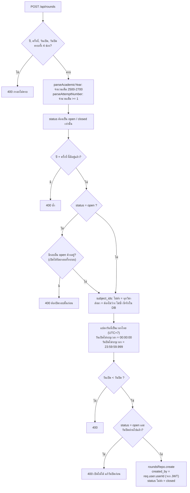

### 9.2 แก้รอบ (`update`) — ด่านที่คนงงบ่อย

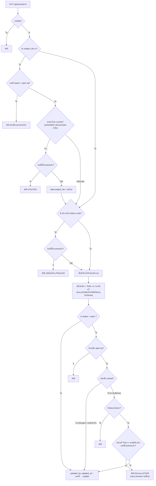

### 9.3 ลบรอบ (`remove`)

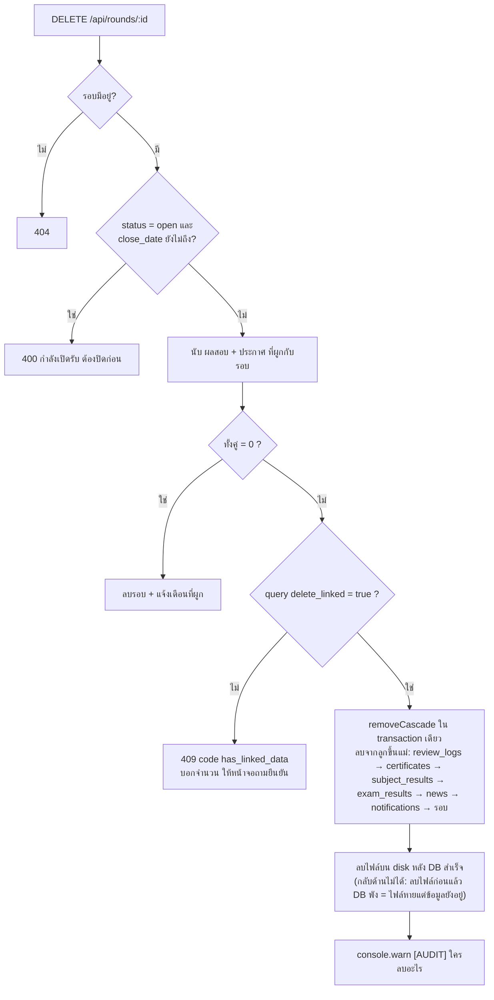

---

## 10. นักศึกษา: import / โปรไฟล์ / เปิดสิทธิ์ / ลบ

### 10.1 ปีการศึกษาที่จบ (`utils/academicYear.js`)

```
ปีจบ = 2500 + (2 หลักแรกของรหัส) + 4        เช่น 66xxxxxxxx → 2566 + 4 = 2570
```

ปีจบคือตัวกำหนด **รุ่น** → กำหนดว่านักศึกษาเห็นรอบสอบไหน และเป็นตัวหารของสถิติ จึงห้ามนักศึกษาตั้งเอง

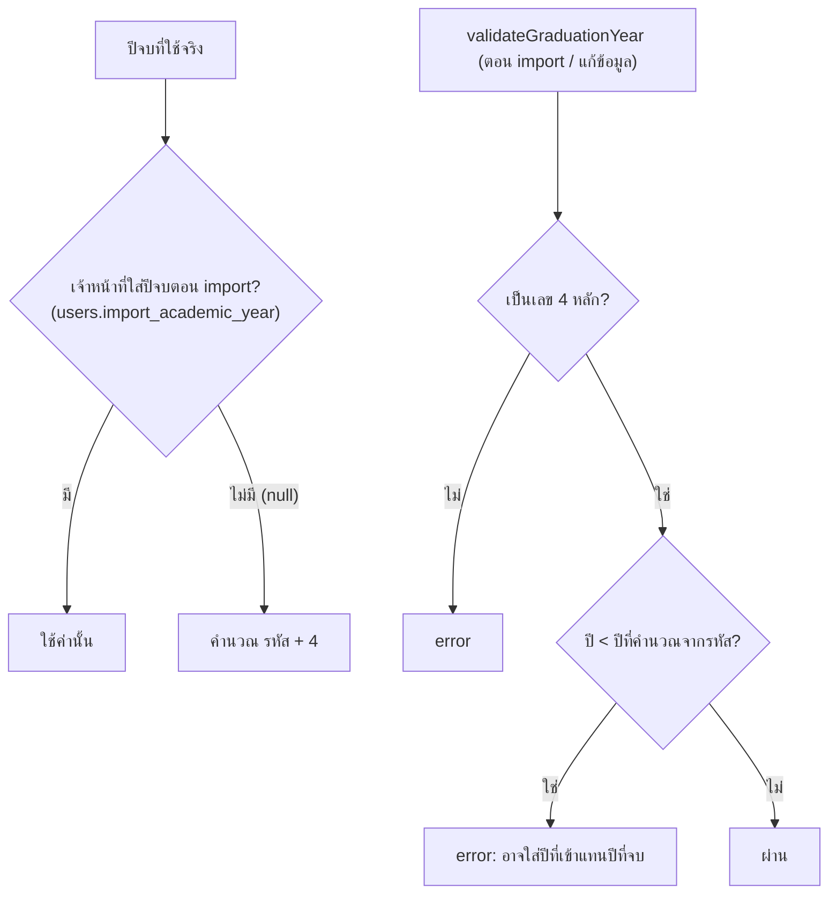

### 10.2 import รายชื่อ (`bulkImport`) — ทำทีละแถว ไม่ใช่ transaction เดียว

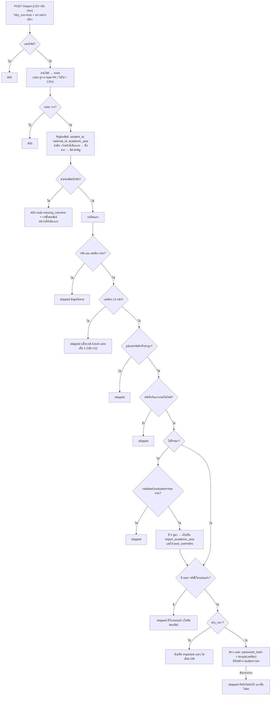

สรุปความหมาย: **import สร้างแค่ `users`** (บัญชีที่ยังไม่มี `students` row) → คนกลุ่มนี้เรียก "pending account" → dashboard นับเป็นสมาชิกรุ่นที่ "ยังไม่กรอก" (ดู `countStudentsByYear` ข้อ 11)

### 10.3 นักศึกษากรอกโปรไฟล์ครั้งแรก (`completeProfile`)

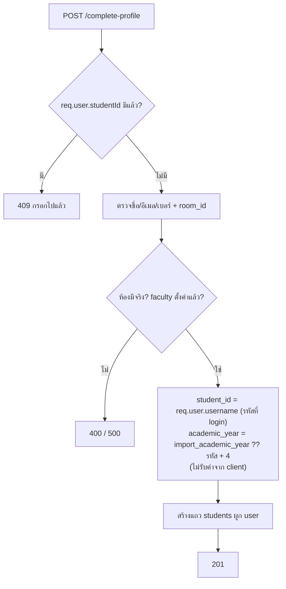

### 10.4 เปิด/ปิดสิทธิ์กรอกผล (`bulkSetEligible`)

กับดักที่สำคัญ: Prisma ตีความ `{ in: undefined }` ว่า **"ไม่มีเงื่อนไข"** → `updateMany` กวาดทั้งตาราง

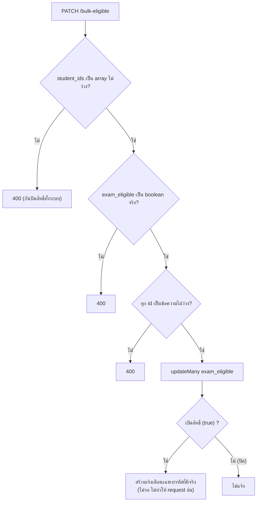

### 10.5 ลบนักศึกษา (`deleteStudents`)

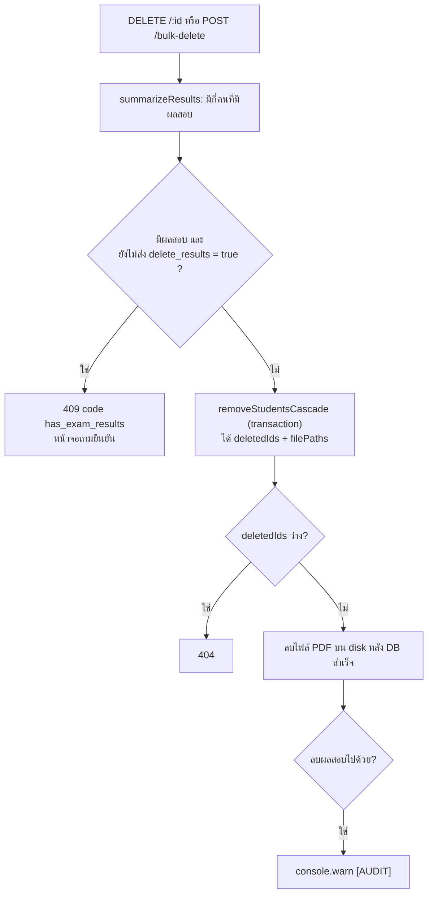

---

## 11. Dashboard: ตัวเลขทุกตัวมาจากไหน

**อ่านข้อนี้ก่อนข้อ 12–13 — ถ้าเข้าใจ 3 ตัวกรอง + ตัวหาร ก็เข้าใจ dashboard 80% แล้ว**

### 11.1 ตัวกรองใบผลสอบ 4 ตัว (ฟังก์ชันเล็กๆ ที่ต้นไฟล์ `dashboard.service.js`)

| ฟังก์ชัน | เก็บใบที่... | ตัดออก | ใช้กับ |
|---|---|---|---|
| `onlySent` | `student_status ≠ draft` | draft | ฐานของทุกอย่าง ("ส่งแล้ว") |
| `notRejected` | `staff_status ≠ rejected` | ถูกตีกลับ | fillRate รายปี |
| **`onlyConfirmed`** | **`staff_status = approved`** | pending, rejected | **ทุกตัวเลขที่แปลว่า "ผ่าน"** |

**กฎทอง:** ตัวเลขที่แปลว่า "ผ่าน" นับ **เฉพาะใบ approved** เท่านั้น (ผลที่นักศึกษากรอกเองยังไม่มีใครเทียบกับใบรายงานผลสอบ)
ใบ pending ไม่ได้หายไป — ยังนับเป็น "ส่งแล้ว" และหน้าจอเตือนว่ามีกี่ใบที่ยังไม่นับ

### 11.2 `carried_forward` — แถวที่ "ไม่ใช่การสอบจริง"

วิชาที่ถูกยกมาจากรอบก่อนมี `carried_forward = true` กฎ: **ไม่นับเป็นผู้เข้าสอบวิชานั้น** ทั้งในรายวิชา, ตารางรอบแรก, และสะสมรายปี
(เหตุผลบั๊ก B1: ถ้าใบต้นทางถูกตีกลับทีหลัง สำเนาที่ยกมาจะค้างเป็น "ผ่าน" ผิดๆ)

### 11.3 ตัวหาร (denominator)

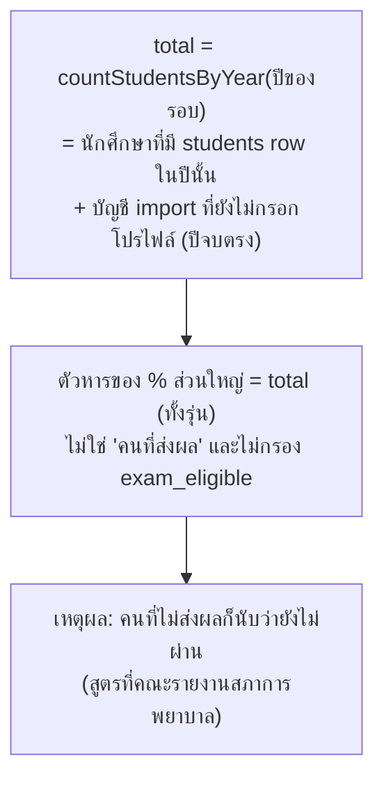

มีตัวหารที่ **ต่างจาก total** 3 ตัว (ต้องติดป้ายให้ชัด):

| ตัวเลข | ตัวหาร |
|---|---|
| `passRateOfSitters` | `confirmed.length` (คนที่ยืนยันแล้วในรอบนี้) |
| รายวิชา `perSubject[].rate` | `pass + fail` (คนที่สอบวิชานั้นจริง ไม่รวม carried_forward) |
| `roundFillRate` | `roundTotal` (คนที่ต้องกรอกในรอบนี้) |

### 11.4 ตารางสูตรทั้งหมด

| ตัวเลขใน response | สูตร | ฐาน (ตัวตั้ง) | ตัวหาร |
|---|---|---|---|
| `submitted` | นับ | `onlySent(results)` | — |
| `fillRate` | `percent(submitted, total)` | ส่งแล้ว (รวม pending/rejected) | `total` |
| `confirmed` | นับ | ใบ approved ในรอบ | — |
| `fullyPassed` | `countFullyPassed(confirmed, subjectIds)` | approved + ผ่านทุกวิชาของรอบ | — |
| `fullyPassedRate` | `percent(fullyPassed, total)` | | `total` |
| `passRateOfSitters` | `percent(fullyPassed, confirmed.length)` | | คนที่ยืนยันแล้ว |
| `perSubject[i]` | pass / fail / rate | approved + ไม่ carried_forward | `pass+fail` (rate = null ถ้าไม่มีคนสอบ) |
| `subjectPassRate` | `percent(totalPass, totalMarks)` | รวมทุกวิชาที่มีคนสอบ | ผลสอบรวม |
| `by` | draft / submitted(=pending) / approved / rejected | ทุกใบในรอบ | — |
| `not_started` | `max(total − results.length, 0)` | | |
| `canSubmit` | เปิดสิทธิ์ และ ยังผ่านไม่ครบวิชาของรอบ | | |
| `roundTotal` | canSubmitIds ∪ คนที่มีใบในรอบ | | |
| `firstAttempt.passed` (รายปี) | ใบรอบ 1 approved + ผ่านครบ | | `total` |
| `firstYear.passed` (รายปี) | ผลสะสม approved ทุกรอบของปี ครบวิชาของรอบ 1 | | `total` |

หมายเหตุสูตร:
- `percent` = ปัดเป็นจำนวนเต็ม; `rate2` = ทศนิยม 2 ตำแหน่ง (ใช้กับตัวเลขที่ส่งสภาการพยาบาล) ทั้งคู่ตัวหาร 0 → คืน 0
- `countFullyPassed` ถ้ารอบไม่มีวิชาเลย (`subjectIds` ว่าง) คืน **0** — เพราะ `[].every()` ให้ `true` เสมอ จะทำให้ทุกคนถูกนับว่าผ่านครบทั้งที่ไม่ได้สอบ

### 11.5 `by` แยกสถานะ (`countByStatus`) — ลำดับ if สำคัญ

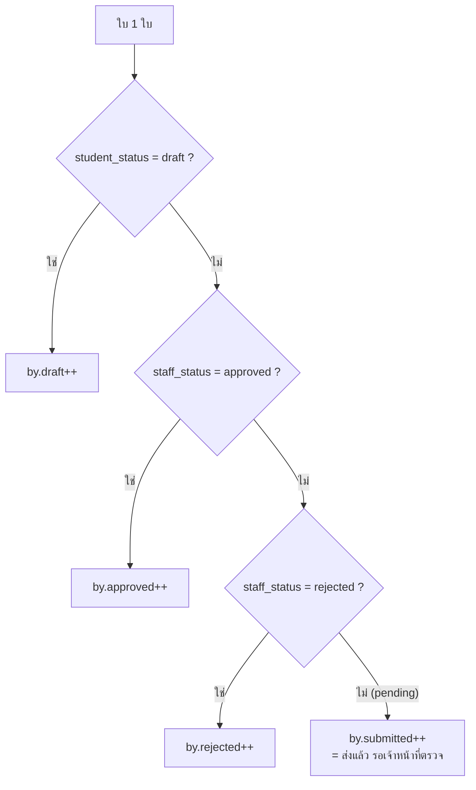

ชื่อ `submitted` ใน `by` **ไม่ใช่** "ส่งแล้วทั้งหมด" แต่คือ "ส่งแล้วและยังรอตรวจ" (ต่างจากตัวแปร `submitted` ตัวเลข ซึ่งรวมทั้งหมด)
5 ช่อง `approved + submitted + rejected + draft + not_started` บวกกันได้ `total` พอดีเสมอ

---

## 12. Dashboard: `buildStats` (รายรอบ) — `GET /api/dashboard/stats?round_id=`

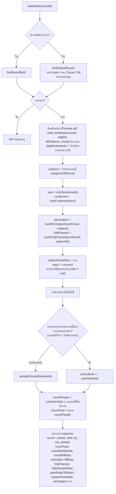

**ทำไมมี `roundTotal` แยกจาก `total`**: รอบ 2 ขึ้นไป คนที่ผ่านครบแล้วไม่ต้องกรอกอีก ถ้าเอามาอยู่ในตัวหารของแถบความคืบหน้า จะได้เช่น "29/155" ทั้งที่คนที่ต้องกรอกจริงมี 42 คน → มุมมองรายรอบใช้ `roundTotal` ส่วนสูตร "ผ่าน" ใช้ `total` ทั้งรุ่น

**วิชาที่เคยผ่านก่อนรอบนี้** (`findEligibleWithPassedSubjects`) นับจากรอบที่ "มาก่อน" เท่านั้น (ปีเก่ากว่า หรือปีเดียวกันแต่ attempt น้อยกว่า) — ห้ามเอารอบอนาคตมาตัดสินอดีต. เงื่อนไขเหมือน `findPassedSubjectIds`: `is_passed`, ไม่ carried_forward, ไม่ rejected

---

## 13. Dashboard: `buildYearSummary` (รายปี) — `GET /api/dashboard/history`

หัวใจ: **นับ "รายคน" ไม่ใช่ "รายใบ"** เพราะคนเดียวส่งได้หลายรอบในปีเดียว

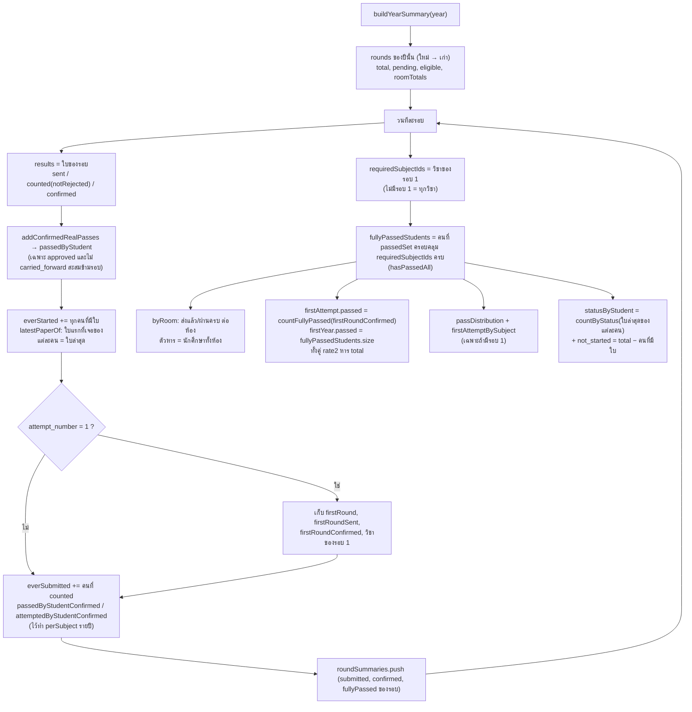

### 13.1 ผ่านครั้งแรก vs ผ่านภายในปีแรก

```mermaid
flowchart LR
    subgraph FA["firstAttempt (ผ่านครั้งแรก)"]
        A1["ดูเฉพาะใบ รอบที่ 1"] --> A2["approved + ผ่านครบวิชารอบ 1"]
    end
    subgraph FY["firstYear (ผ่านภายในปีแรก)"]
        B1["รวมผล approved ของทุกรอบในปี<br/>(1+2+3) ไม่นับ carried_forward"] --> B2["Set วิชาที่ผ่านจริงของแต่ละคน<br/>ครอบคลุมวิชารอบ 1 ครบ"]
    end
    FA --> C["firstYear ≥ firstAttempt เสมอ<br/>(คนผ่านรอบ 1 ถูกนับในปีแรกด้วย)"]
    FY --> C
```

ใช้ฟังก์ชันชุดเดียวกัน (`addConfirmedRealPasses`, `getRequiredSubjectIds`, `hasPassedAll`) ทั้งตัวเลขบนการ์ดและไฟล์ส่งออกรายชื่อ (`buildFirstYearList`) → ตัวเลขต้องตรงกันเสมอ ถ้าจะแก้กฎ แก้ที่เดียว

### 13.2 ตารางผ่านกี่วิชา (`buildPassDistribution`)

```mermaid
flowchart TD
    S["ใบรอบ 1 ที่ approved"] --> A["นับรายคนว่าผ่านกี่วิชา (n)"]
    A --> B["rows[n][ห้อง]++"]
    B --> C["สร้างแถว n = จำนวนวิชา ... 0 (แถวที่ไม่มีคนก็ยังแสดง 0)"]
    C --> D["แถวท้าย not_submitted<br/>= นักศึกษาทั้งห้อง − คนที่ approved รอบ 1 ของห้องนั้น"]
    D --> E["ผลรวมทุกแถว = นักศึกษาทั้งรุ่น เสมอ"]
```

`not_submitted` จึงรวมทั้งคนที่ไม่ส่ง, ค้างรอตรวจ, และถูกตีกลับ (เพราะฐานคือ approved)

### 13.3 ตารางรายวิชารอบแรก (`buildFirstAttemptBySubject`)

ต่อวิชา 3 ช่อง **บวกกัน = ทั้งรุ่น เสมอ**:
- `pass` = approved + ไม่ carried_forward + ผ่าน
- `fail` = approved + ไม่ carried_forward + ไม่ผ่าน
- `not_submitted` = `cohortTotal − pass − fail`

เศษทศนิยม: `notSubmittedRate = 100 − passRate − failRate` (ยกเศษมาช่องสุดท้าย ให้รวมได้ 100.00 พอดี ไม่เป็น 99.99)
`sat = pass + fail` ถ้า 0 = ไม่มีใครสอบวิชานี้ → หน้าจอขึ้นขีด ไม่ใช่ 0.00%
`average_pass_rate` เฉลี่ยเฉพาะวิชาที่ `sat > 0`
แถวรวม: `passed_all` / `failed_any` **นับเป็นคน** ไม่ใช่บวกคอลัมน์ (บวกคอลัมน์จะได้ 156×8 = 1248 ที่ไม่ใช่จำนวนคน)

---

## 14. Dashboard: ตัวอย่างคำนวณด้วยตัวเลข (สมมติ)

รุ่น 2570 มี **100 คน** (`total = 100`) รอบ 1 มี 3 วิชา A B C

| สถานะใบรอบ 1 | จำนวนคน |
|---|---|
| approved ผ่านครบ A B C | 60 |
| approved ผ่าน A B ตก C | 15 |
| pending (รอตรวจ) | 10 |
| rejected | 5 |
| ไม่ส่งเลย | 10 |

คำนวณ:

| ตัวเลข | ค่า | วิธีได้ |
|---|---|---|
| `submitted` | 90 | 60+15+10+5 (ไม่รวมคนไม่ส่ง) |
| `fillRate` | 90% | 90/100 |
| `confirmed` | 75 | 60+15 |
| `fullyPassed` | 60 | approved ผ่านครบ |
| `fullyPassedRate` | 60% | 60/**100** (ทั้งรุ่น) |
| `passRateOfSitters` | 80% | 60/**75** (คนที่ยืนยันแล้ว) |
| `perSubject` C | pass 60, fail 15, rate 80% | นับจาก approved 75 คน |
| `by` | approved 75, submitted 10, rejected 5, draft 0 | |
| `not_started` | 10 | 100 − 90 ใบ |
| `firstAttempt` | 60 คน, 60.00% | |

สังเกต: 60% กับ 80% ไม่ขัดกัน — แค่ตัวหารต่างกัน (ทั้งรุ่น vs คนที่ยืนยันแล้ว) จึงต้องติดป้ายกำกับบนหน้าจอเสมอ
ถ้าเจ้าหน้าที่ยืนยัน pending 10 ใบเพิ่ม (ผ่านครบ 6 ใบ) → `fullyPassed` = 66, `fullyPassedRate` = 66%

---

## 15. Dashboard: แจ้งเตือนของเจ้าหน้าที่/ผู้บริหาร (`buildAlerts`)

คำนวณสดทุกครั้ง **ไม่เก็บลง DB** (เป็น "สถานะตอนนี้" ไม่ใช่เหตุการณ์ จึงไม่มีแจ้งเตือนเก่าค้าง)

```mermaid
flowchart TD
    S["buildAlerts(role)"] --> A{"ไม่มีรอบเลย?"}
    A -->|"ใช่"| Z0["alerts = []"]
    A -->|"ไม่"| B["วนทุกรอบที่ status = open"]
    B --> C["left = วันที่เหลือก่อน close_date<br/>นับเป็น 'วัน' ตามเวลาไทย UTC+7"]
    C --> D{"left < 0 ?"}
    D -->|"ใช่"| D1["เตือน round_overdue<br/>เลยกำหนดแล้ว n วัน ยังไม่ปิด"]
    D -->|"ไม่"| E{"left ≤ 7 ?"}
    E -->|"ใช่"| E1["เตือน round_closing<br/>เหลือ n วัน / วันนี้วันสุดท้าย"]
    E -->|"ไม่"| F
    D1 --> F
    E1 --> F{"0 ≤ left ≤ 7 ?"}
    F -->|"ใช่"| G["buildStats(รอบ)<br/>missing = roundNotStarted + by.draft"]
    G --> G1{"missing > 0 ?"}
    G1 -->|"ใช่"| G2["เตือน not_submitted<br/>(ฐาน = roundTotal ไม่ใช่ทั้งรุ่น)"]
    F -->|"ไม่"| H
    G2 --> H{"role = officer ?"}
    G1 -->|"ไม่"| H
    H -->|"ใช่"| I["วน 'ทุกรอบ' (ไม่ใช่เฉพาะที่เปิด)<br/>pending = by.submitted"]
    I --> J{"pending > 0 ?"}
    J -->|"ใช่"| K["เตือน pending_review<br/>(ใบค้างตรวจของรอบเก่าไม่หาย)"]
    H -->|"ไม่ (executive)"| Z["คืน alerts"]
```

---

## จุดที่คนมักเข้าใจผิด (สรุป)

1. **status กับ phase ไม่ใช่ตัวเดียวกัน** — status เก็บใน DB (เจ้าหน้าที่กด), phase คำนวณตามเวลา
2. **`by.submitted` = รอตรวจ ไม่ใช่ส่งทั้งหมด**
3. **"ผ่าน" ทุกตัว = นับเฉพาะ approved** — pending ไม่เข้า แต่ยังนับเป็น "ส่งแล้ว"
4. **ตัวหารทั้งรุ่น (`total`) รวมบัญชี import ที่ยังไม่เคย login** และไม่กรอง `exam_eligible`
5. **carried_forward ไม่ใช่การสอบจริง** — ไม่นับผู้เข้าสอบ ไม่นับผ่านสะสม
6. **ใบ rejected ไม่นับเป็น "เคยผ่าน"** (เปิดให้กรอกวิชานั้นใหม่) แต่ **pending นับ** (ไม่งั้นต้องกรอกซ้ำก่อนเจ้าหน้าที่ตรวจ)
7. รายปีนับ **รายคน** ถือใบล่าสุดเป็นสถานะปัจจุบัน — ห้ามเอา `by` รายรอบมาบวกกัน (จะเกิน 100%)
8. ทุกที่ที่เปลี่ยนใบ ต้อง **ล็อกแถว `exam_results` ก่อน** แล้วเช็คสถานะซ้ำ — เช็คใน controller เป็นแค่ด่านแรกให้ข้อความชัด
9. `updateMany` ที่ where เป็น `undefined` = กวาดทั้งตาราง (กับดัก Prisma) จึงต้องเช็ค input ก่อนเสมอ
